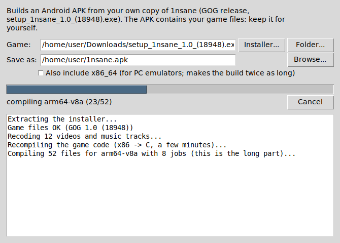

# 1nsane Android port

A static recompilation of **1nsane** (Invictus / Codemasters, 2000) into portable C, with a reimplementation of
the Windows, DirectDraw 7 / Direct3D 7, DirectSound, DirectInput, winmm and DirectShow APIs it uses on top of
SDL2 and OpenGL ES 3. It runs on **Android** (arm64, x86_64) and **Linux**.

> **Bring your own game files.** This repository contains **no game code or data**. The APK builder takes
> **your own copy** of the game, recompiles it and packs it into an APK on your machine. It is made for the
> **GOG release** (`setup_1nsane_1.0_(18948).exe`); other versions are refused, because the recompiled code
> and its hooks are specific to that build. The APK you build contains your game files: keep it for
> yourself, don't distribute it.

## Building the APK

### The easy way: the APK builder (Windows, Linux, macOS)

Download the builder for your computer from the [releases](../../releases) page. Builds are available for
**Windows x64**, **Linux x64** and **macOS** (Apple Silicon `arm64` and Intel `x64`), in two editions:

| download | |
|---|---|
| `…-full` | includes everything, works offline |
| `…-light` | smaller; downloads the Zig C compiler (pinned version, checksum verified) the first time |

Nothing else needs to be installed: no Python, no Android SDK, no Java.

1. Unpack it and start `insane-apk-builder`.
2. Choose your **GOG installer** (`setup_1nsane_1.0_(18948).exe`) or the folder where the game is installed.
3. Press **Build APK**.



The first build takes roughly 10–40 minutes, depending on the computer: the game's code is recompiled to C
(about 4,000 functions) and compiled for Android, and the videos and music are re-encoded. Later builds
reuse that work. Tick *x86_64* only if you want to run it in a PC Android emulator.

Command line (same program, with arguments):

```sh
insane-apk-builder "setup_1nsane_1.0_(18948).exe" -o 1nsane.apk [--abi arm64-v8a,x86_64] [--jobs N]
```

The builder creates a personal signing key the first time (in your user config folder,
`insane-apk-builder/signing-key.txt`). Keep it: APKs signed with the same key install as updates and keep
your saves.

On macOS the program is not notarised; if it is refused, run
`xattr -dr com.apple.quarantine insane-apk-builder` once.

**Install** the APK by copying it to the phone and opening it, or with `adb install -r 1nsane.apk`.
On first launch the app unpacks the game data (~235 MB) to its private storage; later launches start immediately.

### From source

```sh
./build.sh "setup_1nsane_1.0_(18948).exe"           # -> dist/1nsane.apk
./build.sh "setup_1nsane_1.0_(18948).exe" desktop   # -> ./insane (Linux)
```

`apk` needs only `python3` (with `venv`): it runs the builder from source. The runtime template APK is built
with Gradle if `ANDROID_HOME` (or `~/android-sdk`) has an Android SDK (NDK 27.2.12479018, CMake 3.22.1,
JDK 17), otherwise it is downloaded from the latest release. `desktop` needs `innoextract`, `clang`, `make`
and the SDL2 and GLES3 development packages; run it with `./insane game/app save` (fullscreen;
`C2_WIN=1280x720 ./insane ...` for a window).

## Enhancements over the original

* **Native on Android and Linux**: the game's x86 code (`Game.exe` and the force-feedback library
  `IFC21.dll`) is recompiled ahead of time to C; nothing is emulated at run time. The game's Direct3D
  renderer runs on OpenGL ES 3.
* **Widescreen (Hor+)**: races fill the whole screen at its native aspect ratio. The game's race camera is
  given a wider field of view, so its own culling and terrain detail cover the full width (no missing
  scenery at the sides); the HUD keeps its 4:3 layout in the middle, undistorted and lined up with the 3D
  view. Menus and videos are shown in 4:3.
* **High resolution**: everything is rendered at a multiple of the game's resolution to fit the screen.
* **Mobile GPU friendly renderer**: draws are recorded and submitted in batches (one vertex upload, same-state
  draws merged), with a GL state cache and a fragment shader compiled per texture-stage setup.
* **Selectable frame rate cap** (30 / 60 / 120 / unlimited), see below; the game runs at the same speed at
  any frame rate.
* **Videos** (Indeo 5, which nothing on a phone can decode) are re-encoded to MPEG-1 and played with
  [pl_mpeg](https://github.com/phoboslab/pl_mpeg), in sync with their soundtrack.
* **Music** (360 MB of WAV) is stored as MP2 (~60 MB) and decoded while the game streams it.
* **Game controllers** with proportional steering and pedals, and **touch controls** including a diff lock
  button; the touch controls hide while a controller is in use.
* Not available: multiplayer (DirectPlay) and force feedback.

## Frame rate and performance readout

| setting | behaviour |
|---|---|
| **30** | 30 fps, lowest power use |
| **60** (default) | 60 fps (on a 120 Hz screen every second refresh) |
| **120** | 120 fps on a 120 Hz screen |
| **unlimited** | no cap, vsync off |

The game's speed is the same at every frame rate (checked with the virtual clock at 30 and 120 fps).

**Android**: tap the screen with **three fingers** to show the readout, **tap the readout** to step through
the caps; three fingers again hides it. **Desktop**: **F11** steps through the caps (F9 is the game's camera
key); `C2_PERF=1` shows the readout. The choice is saved (`fpscap` in `insane.cfg`).

`FPS 60  CAP 60  GAME 6.4  GL 1.0  SWAP 0.7`: frames per second, the cap, and milliseconds per frame in
the game's own (recompiled) code, in the renderer (vertex processing and GL submission), and waiting for
the GPU / vsync.

## Controls

**Touch** (Android). Races: steer left/right; gas, brake, handbrake; rescue (SOS), repair, rollover;
rear view, map, **diff lock**; camera, pause. Menus: arrows, OK, back. Touching empty screen is Enter
(it starts a race from the instructions screen). The buttons hide while a game controller is in use.

**Game controller**

| control | action (game key) |
|---|---|
| left stick / D-pad | steer (arrows; the stick is proportional) and menu navigation |
| RT / LT | accelerate / brake-reverse (proportional) |
| A / B / Start | Enter / Esc / Esc (pause) |
| X | handbrake (Space) |
| Y | rescue (R) |
| LB | diff lock (L) |
| RB | camera (F9) |
| Back | big map (Alt) |
| L3 / R3 | horn (Num Enter) / lights (Right Ctrl) |
| right stick | up rollover (Num 0), down repair (Backspace), left cycle gate (Tab), right rear view (Right Shift) |

The stick and triggers drive the game's digital controls pulse-width modulated, so half a push steers
about half as hard. Android Back is Esc (skips videos, pauses).

## Testing switches (desktop)

`C2_WIN=WxH` window instead of fullscreen, `C2_NOVIDEO=1` skip videos, `C2_TOUCH=1` show the touch overlay,
`C2_KEYS="ms:vk:down,..."` scripted keys, `C2_WINSHOT=n,m` screenshots of those frames,
`C2_D3DLOG=n` log every draw of frame n, `C2_EXTRAMODE=WxH` extra display mode.

## Layout

`tools/lift.py` x86 -> C recompiler · `runtime/` memory, dispatch, x87 · `win32/` API reimplementations
(`ddraw.c` DirectDraw/Direct3D on GLES 3, `video.c` DirectShow streams, `extra.c` registry, mmio,
timers) · `platform/` SDL window, input, touch overlay · `android/` Gradle project.
